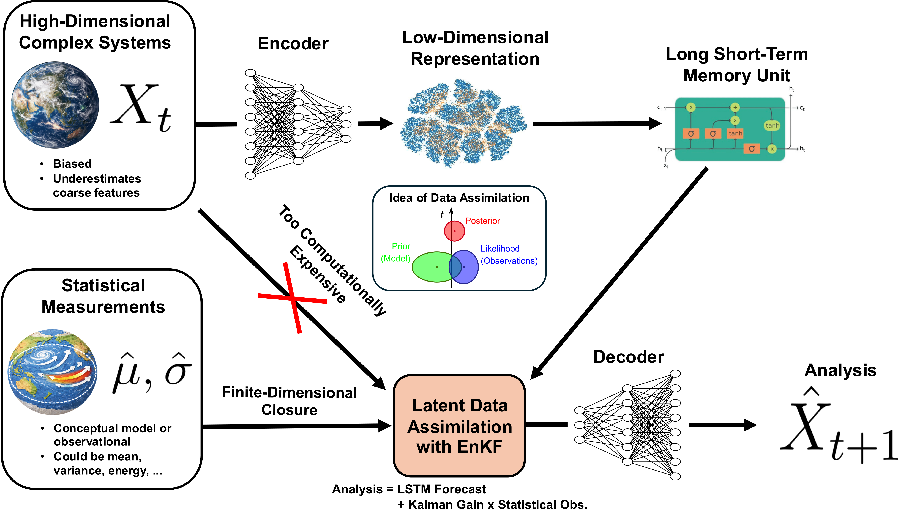

# Learning Statistically Accurate Dynamics of Complex Systems

**University of Wisconsin–Madison · MXM Spring 2026**

**Authors:** Daniel Youngberg, Tan Bui, Cody McKenna, and Singer Xing.

[Read the final report](report/final-report.pdf)

This research investigates how learned low-dimensional dynamical models can incorporate statistical observations to represent complex stochastic systems. The framework combines autoencoder representations, LSTM forecasting, and a proposed ensemble Kalman filtering (EnKF) correction stage.

## Research presented

- **Lorenz–96:** autoencoder reconstruction and latent LSTM forecasting with a representation augmented by sparse physical observations.
- **Statistical-observation extension:** a framework for coupling aggregate information, such as moments, with the learned latent representation.
- **FitzHugh–Nagumo:** forecasting experiments incorporating statistical observations, with comparisons of latent dynamics, physical variables, and spiking behavior.

**Implementation status:** Full EnKF implementation remains future work. The included figures show reconstruction and forecasting results; they do not establish completed EnKF correction results.

## Reading guide

| Material | Why it is included |
| --- | --- |
| [Research poster](poster/research-poster.pdf) | A compact visual overview of the team's motivation, framework, FHN results, and future work. |
| [Final report](report/final-report.pdf) | The team's research narrative, methodology, results, and references. |
| [Methods walkthrough](docs/methods-walkthrough.md) | A code-free companion explaining the baseline, statistical observations, two extension approaches, and proposed filtering stage. Adapted from the original Overleaf walkthrough; not a verbatim copy. |

The walkthrough distinguishes the eight learned coordinates from physical or statistical observations and explains how the observation dimensions depend on the chosen configuration. Its source notes identify details that differ between the original documents. It summarizes team work without assigning individual ownership of particular experiments.

## Figures

| Figure | View |
| --- | --- |
| Lorenz–96 autoencoder reconstruction | [Figure](figures/autoencoder-results.png) |
| Lorenz–96 LSTM forecasting | [Figure](figures/lstm-results.png) |
| FitzHugh–Nagumo latent dynamics | [Figure](figures/FHNLatent.png) |
| FitzHugh–Nagumo physical variable u | [Figure](figures/FHNuSlice.png) |
| FitzHugh–Nagumo physical variable v | [Figure](figures/FHNvSlice.png) |
| FitzHugh–Nagumo spike statistics | [Figure](figures/FHNSpikeStats.png) |

The original report and figures are preserved as exported from Overleaf. The poster was compiled locally from unchanged Overleaf source, preserving its wording and team credits. The methods walkthrough is a separate explanatory adaptation. This repository contains research documents and figures; computational source code is not included. See [source and attribution](SOURCE.md) for the export record and document provenance.
